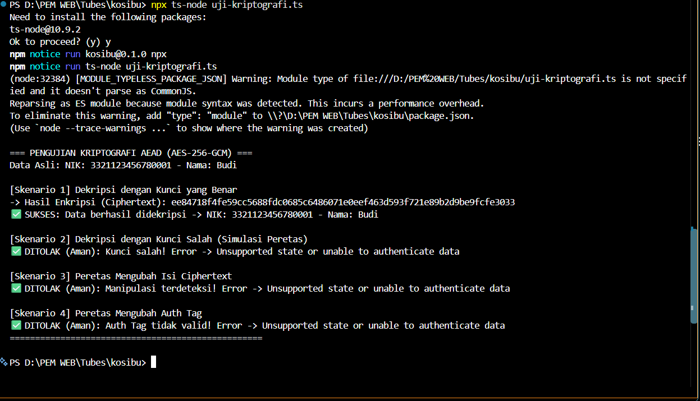

# Keputusan Desain Kriptografi: Implementasi AEAD

## Skenario Penggunaan
Sistem manajemen Kosibu perlu menyimpan data sensitif calon penyewa, seperti Nomor Induk Kependudukan (NIK) atau nomor telepon. Data ini rentan terhadap dua jenis serangan utama:
1. **Pencurian Data (Eavesdropping):** Pihak tidak berwenang membaca isi data.
2. **Manipulasi Data (Tampering):** Pihak tidak berwenang memodifikasi isi data (misalnya, mengubah NIK atau nominal tagihan di *database*).

## Pemilihan Algoritma
Untuk mengatasi kedua ancaman tersebut sekaligus, kami menggunakan enkripsi terautentikasi dengan data tambahan (AEAD - *Authenticated Encryption with Associated Data*). Algoritma yang dipilih adalah **AES-256-GCM** (Advanced Encryption Standard dengan mode Galois/Counter).

## Alasan Pemilihan AES-256-GCM
1. **Kerahasiaan dan Integritas Sekaligus:** Mode GCM tidak hanya mengenkripsi teks (*ciphertext*), tetapi juga menghasilkan *Authentication Tag*. Jika ada 1 bit saja dari data yang diubah oleh peretas, proses dekripsi akan langsung menolak dan menggagalkan operasi tersebut (mencegah *tampering*).
2. **Kinerja Tinggi:** AES-GCM didukung oleh akselerasi perangkat keras (*hardware acceleration*) di sebagian besar prosesor modern, membuatnya jauh lebih cepat dibandingkan mode enkripsi lainnya secara komputasi.
3. **Standar Keamanan Industri:** Menjadi standar yang direkomendasikan oleh NIST dan diadopsi secara luas pada protokol aman seperti TLS 1.3.

## Komponen Kriptografi
- **Key (Kunci Rahasia):** Kunci simetris 256-bit yang harus disimpan secara aman di variabel lingkungan (*environment variables*).
- **IV (Initialization Vector):** Vektor inisialisasi acak sebesar 12 *bytes* yang dihasilkan unik setiap kali enkripsi dilakukan untuk memastikan hasil *ciphertext* selalu berbeda meskipun pesannya sama.
- **Auth Tag:** Tag autentikasi 16 *bytes* yang memverifikasi bahwa data tidak rusak atau diubah secara ilegal.

## Hasil Pengujian Skenario
Berikut adalah bukti eksekusi 4 skenario pengujian AEAD (Keberhasilan Dekripsi, Simulasi Kunci Salah, dan Modifikasi Data):

