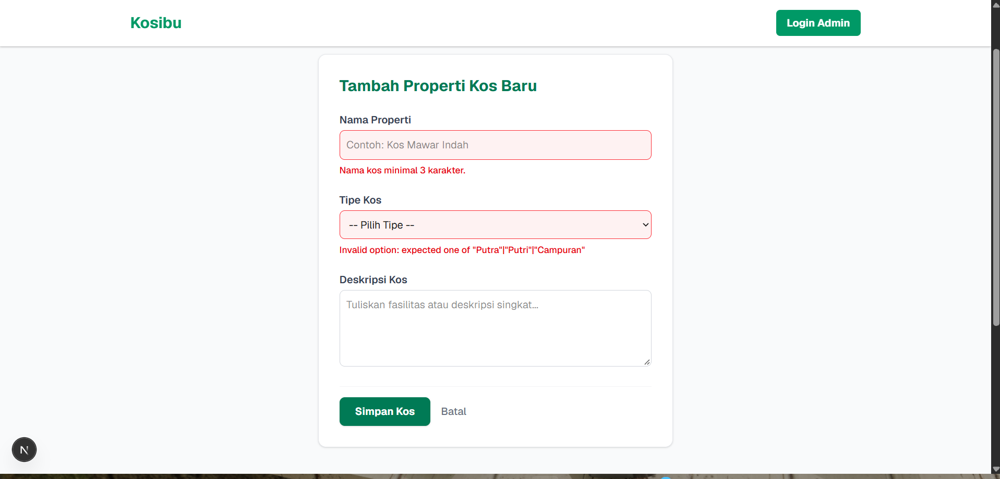
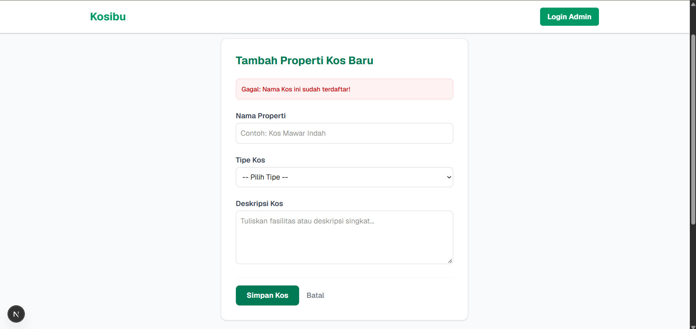
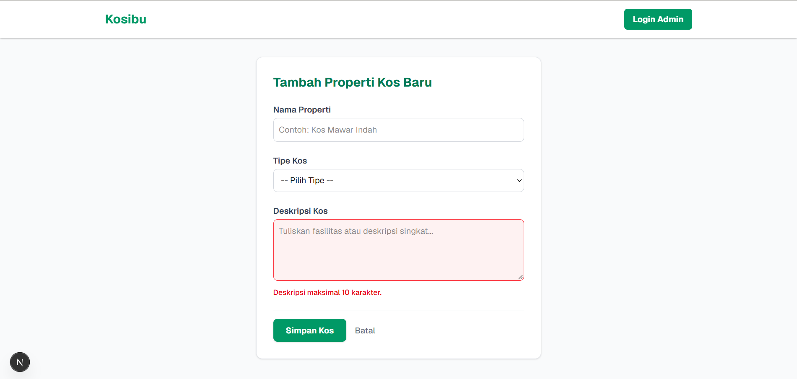

# Kosibu - Sistem Informasi Kos Putri Demak

Kosibu adalah sebuah aplikasi web yang dirancang untuk mempermudah pengelolaan dan pencarian kamar kos khusus putri yang berlokasi di Demak, Jawa Tengah. Proyek ini dikembangkan sebagai bagian dari Tugas Terintegrasi (Milestone 1 dan 2) untuk mata kuliah Praktikum Pengembangan Aplikasi Web, Keamanan Komputasi dan Siber, serta Kriptografi.

## Konsep Produk

**Permasalahan yang Diselesaikan**
- **Calon Penyewa:** Kesulitan mendapatkan informasi akurat terkait ketersediaan kamar, spesifikasi, dan harga secara *real-time* tanpa harus datang langsung ke lokasi.
- **Pengelola Kos:** Membutuhkan sistem pencatatan digital yang rapi untuk mengubah status ketersediaan kamar dan harga agar tidak bergantung pada catatan manual.

**Sasaran Pengguna**
- **Pencari Kos (Publik):** Mahasiswi atau pekerja perempuan yang mencari hunian nyaman dan strategis.
- **Pengelola/Admin:** Pemilik kos yang perlu mengelola ketersediaan dan data kamar.

**Tujuan Aplikasi**
Menyediakan platform satu pintu yang interaktif, responsif, dan mudah diakses bagi calon penyewa untuk melihat katalog kamar, sekaligus menyediakan ruang dasbor admin bagi pengelola untuk memantau status propertinya.

## Perkembangan Fitur

**Fitur Awal (Milestone 1 - v0.1)**
- Katalog Kamar Dinamis yang ditarik dari *mock data*.
- Desain Responsif & Aksesibel menggunakan sistem grid Tailwind CSS.
- Halaman Login Admin dengan validasi sisi klien (*client-side validation*).
- Dasbor Admin dengan antarmuka tabel sederhana.

**Pembaruan Fitur (Milestone 2 - v0.2)**
Pada tahap ini, aplikasi telah terintegrasi dengan basis data relasional dan logika server yang utuh:
- **Integrasi Database:** Mengganti *mock data* dengan data persisten menggunakan PostgreSQL dan Prisma ORM 7.
- **Logika Server (CRUD):** Implementasi *Server Actions* Next.js untuk membaca, menambah, mengubah, dan menghapus (dengan relasi data/transaksi) data kos.
- **Validasi Sisi Server:** Penggunaan pustaka Zod untuk memvalidasi masukan *form* pengguna secara ketat, serta penanganan galat dari *database* (seperti *Unique Constraint* bila nama kos sudah ada).

## Bukti Validasi Server (Zod)
Berikut adalah bukti penolakan masukan tidak valid dari sisi server yang diimplementasikan pada Milestone 2:

**1. Bukti Validasi Kurang Karakter**


**2. Bukti Validasi Nama Kembar (Unique Constraint - P2002)**


**3. Bukti Validasi Batas Maksimal Karakter**


*(Catatan: Tabel dokumen berisi 10 skenario pengujian CRUD dan relasi data telah dilampirkan pada repositori ini).*

## Teknologi yang Digunakan
- **Framework:** Next.js (App Router)
- **Library UI:** React
- **Bahasa Pemrograman:** TypeScript
- **Styling:** Tailwind CSS
- **Database:** PostgreSQL *(Baru di v0.2)*
- **ORM:** Prisma ORM 7 *(Baru di v0.2)*
- **Validasi Server:** Zod *(Baru di v0.2)*

## Petunjuk Menjalankan Proyek Secara Lokal

Untuk menjalankan aplikasi ini di komputer Anda, ikuti langkah-langkah berikut:

### 1. Kloning Repositori & Instalasi Dependensi
```bash
git clone [https://github.com/rafly1764/Tubes_Kostibu_105224040.git](https://github.com/rafly1764/Tubes_Kostibu_105224040.git)
cd kosibu
npm install
2. Konfigurasi Environment
Salin fail .env.example menjadi .env lalu sesuaikan dengan kredensial PostgreSQL lokal Anda:

cp .env.example .env

3. Migrasi & Seed Database
Jalankan perintah ini untuk membangun tabel berdasarkan skema Prisma dan mengisi data awal (sintetis):

npx prisma migrate dev --name init
npx prisma db seed

4. Jalankan Server Pengembang (Development Server)

npm run dev
Buka http://localhost:3000 di peramban Anda untuk melihat aplikasi, atau langsung masuk ke Dasbor Admin untuk menguji fitur penambahan dan pengelolaan data.