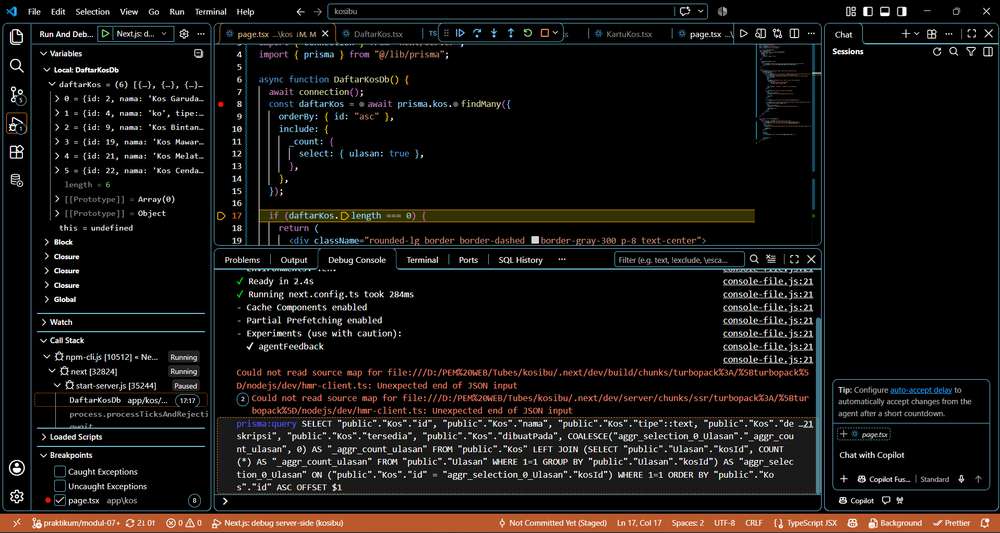
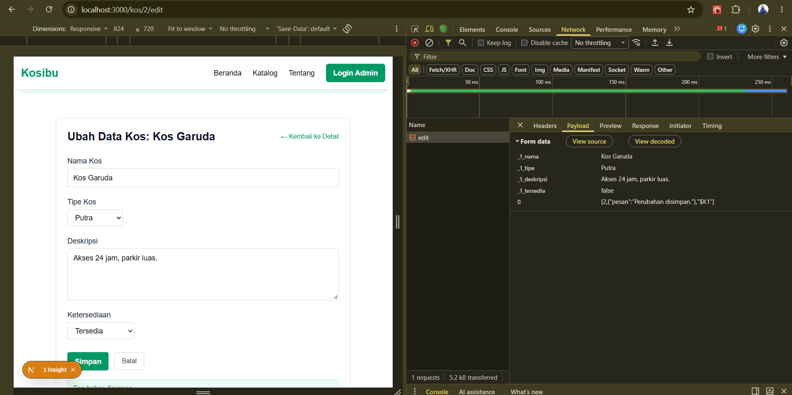
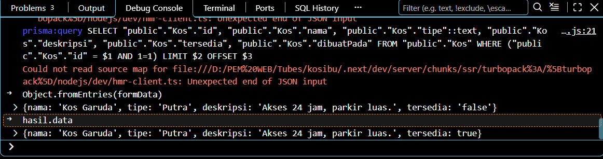
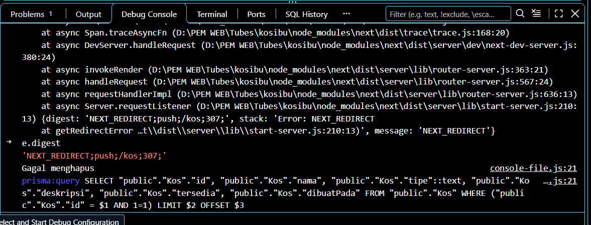
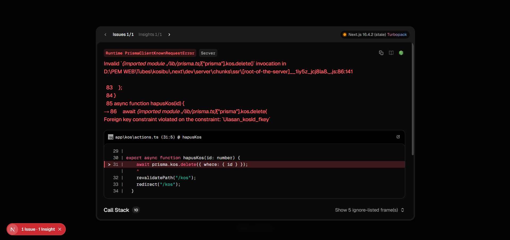
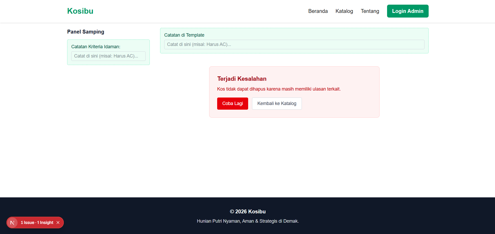

# Dokumen Teknis Modul 7: Debugging dan Telaah Kode

- **Nama / NIM:** Muhammad Rafly / 105224040
- **Proyek:** Kosibu (Aplikasi Manajemen Katalog & Ulasan Kos)
- **Lingkungan:** Next.js 16.4.2 (Turbopack), Prisma 7, PostgreSQL 18, Zod 4, Windows 11, Chrome DevTools, VS Code Debugger
- **Branch & Pull Request:** `praktikum/modul-07` → `main` ([PR #1 Kosibu Modul 7](https://github.com/rafly1764/Tubes_Kostibu_105224040/pull/5))

---

## 1. Konfigurasi Debugging & Pemeriksaan Statis

1. **VS Code Debugger (`.vscode/launch.json`):** Dikonfigurasi profil `Next.js: debug server-side` untuk memasang *breakpoint* langsung pada kode server (`app/kos/page.tsx` dan `app/kos/actions.ts`). Pada Checkpoint 1, eksekusi berhenti tepat di baris 17 `app/kos/page.tsx`, panel **Variables** menampilkan `daftarKos` berisi 6 data dari PostgreSQL, dan **Debug Console** mencetak kueri `prisma:query SELECT ...`.

   

2. **Error Boundary (`app/kos/error.tsx`):** Ditambahkan komponen klien (`"use client"`) untuk menangkap galat pada rute `/kos` secara terstruktur tanpa merusak *layout* utama, dilengkapi pencatatan `console.error(error)`, tampilan kondisional `error.digest`, tombol **Coba Lagi** (`reset()`), serta tautan **Kembali ke Katalog**.
3. **Pemeriksaan Statis:** Setelah seluruh perbaikan dan tindak lanjut telaah diterapkan, perintah `npm run lint` dan `npx tsc --noEmit` berjalan bersih dengan 0 *error* dan 0 *warning*.

---

## 2. Daftar Galat, Bukti Pengujian, dan Perbaikan

### Galat #1 — Status `tersedia` selalu tersimpan `true` akibat `z.coerce.boolean()`
- **GitHub Issue:** `#1` ([Tautan Issue #1](https://github.com/rafly1764/Tubes_Kostibu_105224040/issues/1))
- **Lokasi:** `lib/skema.ts` (`skemaKos`)
- **Langkah Reproduksi:**
  1. Buka `/kos`, pilih kos berstatus **Tersedia** (misal *Kos Garuda*), lalu masuk ke halaman edit `/kos/[id]/edit`.
  2. Ubah kolom **Ketersediaan** menjadi **Tidak tersedia** (`"false"`), lalu klik **Simpan**.
  3. Amati respons halaman dan status kos di `/kos`.
- **Akar Penyebab:** `FormData` mengirim nilai sebagai *string* `"false"`. Penggunaan `z.coerce.boolean()` mengeksekusi `Boolean("false")` di JavaScript yang bernilai `true` karena setiap *string* tidak kosong bersifat *truthy*.
- **Bukti Sebelum Perbaikan:**
  - *Chrome DevTools (Network → Payload):* Klien mengirim `_1_tersedia: false`, namun tampilan formulir kembali ke **Tersedia** meski muncul pesan *"Perubahan disimpan."*

    

  - *VS Code Debugger (`ubahKos`, baris 20):* `Object.fromEntries(formData)` menunjukkan `tersedia: 'false'`, sedangkan `hasil.data` berubah menjadi `tersedia: true`.

    

- **Perbaikan:** Mengganti `tersedia: z.coerce.boolean()` menjadi `tersedia: z.stringbool()` pada `lib/skema.ts` agar `"true"` dipetakan menjadi `true`, `"false"` menjadi `false`, dan *string* di luar nilai sah ditolak saat validasi.
- **Hasil Reproduksi Ulang Sesudah Perbaikan:** Mengubah status *Kos Garuda* menjadi **Tidak tersedia** kini tersimpan sebagai `false` di PostgreSQL dan label pada katalog `/kos` berubah menjadi **Sementara tidak tersedia**.

---

### Galat #2 — `hapusKos` gagal mengarahkan ke `/kos` karena `NEXT_REDIRECT` tertelan `try/catch`
- **GitHub Issue:** `#2` ([Tautan Issue #2](https://github.com/rafly1764/Tubes_Kostibu_105224040/issues/2))
- **Lokasi:** `app/kos/actions.ts` (`hapusKos`)
- **Langkah Reproduksi:**
  1. Buka `/kos`, pilih kos yang memiliki 0 ulasan untuk membuka halaman `/kos/[id]`.
  2. Klik tombol **Hapus**.
  3. Amati navigasi peramban dan keluaran konsol server.
- **Akar Penyebab:** Next.js mengimplementasikan `redirect("/kos")` dengan melempar galat internal (`Error: NEXT_REDIRECT`). Karena `redirect("/kos")` berada di dalam blok `try/catch`, pengecualian tersebut tertangkap blok `catch (e)` dan hanya mencetak `"Gagal menghapus"`, padahal data kos sudah terhapus dari basis data.
- **Bukti Sebelum Perbaikan:**
  - *VS Code Debugger (`hapusKos`, baris 36):* Inspeksi `e` dan `e.digest` di Debug Console menunjukkan `Error: NEXT_REDIRECT` dengan `digest` `NEXT_REDIRECT;replace;/kos;303;`.

    

- **Perbaikan:** Memindahkan `revalidatePath("/kos")` dan `redirect("/kos")` ke **luar** blok `try/catch` pada `hapusKos` agar mekanisme pengalihan internal Next.js tidak tertangkap oleh blok penanganan galat.
- **Hasil Reproduksi Ulang Sesudah Perbaikan:** Menghapus kos tanpa ulasan menghapus data dari basis data dan langsung mengalihkan peramban ke `/kos` tanpa mencetak `"Gagal menghapus"` di konsol server.

---

### Galat #3 — Menghapus kos yang masih memiliki ulasan memicu *unhandled error* Prisma `P2003`
- **GitHub Issue:** `#3` ([Tautan Issue #3](https://github.com/rafly1764/Tubes_Kostibu_105224040/issues/3))
- **Lokasi:** `app/kos/actions.ts` (`hapusKos`) dan `app/kos/error.tsx`
- **Langkah Reproduksi:**
  1. Buka `/kos`, pilih kos yang memiliki minimal 1 ulasan terkait pada tabel `Ulasan`.
  2. Pada halaman `/kos/[id]`, klik tombol **Hapus** kos.
  3. Amati tampilan peramban dan log server.
- **Akar Penyebab:** Kolom relasi `Ulasan.kosId` memiliki *foreign key constraint* (`Ulasan_kosId_fkey`) menuju `Kos.id`. Operasi `prisma.kos.delete()` gagal dengan kode Prisma `P2003`, tetapi belum ditangani di `hapusKos` dan belum ada berkas `app/kos/error.tsx`, sehingga menampilkan *stack trace* mentah di peramban.
- **Bukti Sebelum Perbaikan:**
  - *Runtime Error / Stack Trace:* `Runtime PrismaClientKnownRequestError — Foreign key constraint violated on the constraint: Ulasan_kosId_fkey` pada `app/kos/actions.ts:31`.

    

- **Perbaikan:**
  1. Membungkus hanya operasi `await prisma.kos.delete({ where: { id } })` dalam `try/catch`, menggunakan *type guard* `ambilKodePrisma(error)` untuk memeriksa kode `P2003` (melempar pesan *"Kos tidak dapat dihapus karena masih memiliki ulasan terkait."*) dan `P2025` (data sudah tidak ditemukan), serta meneruskan galat tak terduga lainnya dengan `throw error`.
  2. Menambahkan `app/kos/error.tsx` sebagai *error boundary* khusus segmen rute `/kos` dengan pencatatan `console.error(error)` dan tampilan kondisional `error.digest`.
- **Hasil Reproduksi Ulang Sesudah Perbaikan:** Mengklik **Hapus** pada kos yang masih memiliki ulasan menampilkan kotak pesan galat rapi dari `app/kos/error.tsx` dengan tombol **Coba Lagi** dan **Kembali ke Katalog**, sementara data kos dan ulasan tetap aman.

  

---

### Galat #4 (Temuan ESLint) — *Cascading render* akibat `setState` di dalam `useEffect`
- **Lokasi:** `components/FormUlasan.tsx`
- **Gejala & Akar Penyebab:** `npm run lint` melaporkan galat `react-hooks/set-state-in-effect` dan peringatan `react-hooks/exhaustive-deps` karena nilai `sisa` karakter disimpan di `useState(280)` lalu diperbarui di dalam `useEffect(() => { setSisa(280 - isi.length); }, [])`. Selain memicu *cascading render*, *dependency array* kosong membuat angka sisa karakter tidak pernah berubah saat pengguna mengetik.
- **Perbaikan:** Menghapus `useState` untuk `sisa` beserta `useEffect`, lalu menghitungnya langsung sebagai nilai turunan (*derived value*): `const sisa = 280 - isi.length;`.
- **Verifikasi:** `npm run lint` dan `npx tsc --noEmit` lulus dengan 0 *error* dan 0 *warning*.

---

## 3. Penjelasan Keputusan Teknis & Pembanding Alternatif

### A. Pemilihan Lapisan Validasi (`lib/skema.ts`)
- **Keputusan:** Memperbaiki konversi boolean pada lapisan skema validasi Zod menggunakan `z.stringbool()` di `lib/skema.ts`.
- **Pembanding Alternatif:**
  1. *Konversi manual di Server Action (`formData.get("tersedia") === "true"`):* Menyebabkan duplikasi logika di tiap aksi dan diam-diam mengubah *string* tidak sah (misal `"abc"`) menjadi `false` alih-alih menolak input.
  2. *`z.enum(["true", "false"]).transform(...)`:* Berfungsi benar, tetapi lebih panjang dibanding `z.stringbool()` bawaan Zod 4 yang memang dibuat khusus untuk parsing nilai boolean dari *string* formulir.

### B. Pemisahan `redirect()` dan Penanganan Galat (`app/kos/actions.ts`)
- **Keputusan:** Mempersempit blok `try/catch` hanya pada operasi `prisma.kos.delete()`, memeriksa kode galat menggunakan *type guard* `ambilKodePrisma(error)`, meletakkan `revalidatePath` dan `redirect` di luar `try/catch`, serta melempar ulang (`throw error`) untuk semua galat selain `P2003` dan `P2025`.
- **Pembanding Alternatif:**
  1. *Membiarkan `redirect()` di dalam `try` lalu memfilter `isRedirectError(e)`:* Lebih rentan terlewat saat terjadi perubahan kode dan mencampurkan alur navigasi dengan blok penanganan galat I/O basis data.
  2. *Blok `catch` kosong atau hanya `console.log`:* Anti-pola karena menyembunyikan kegagalan nyata dari pengguna maupun *error boundary*.

### C. Aturan Penghapusan Kos yang Memiliki Ulasan (`P2003`)
- **Keputusan:** Menolak penghapusan (*restrict*) pada level *foreign key* (`P2003`) dan menampilkan pesan terkelola lewat `app/kos/error.tsx`.
- **Pembanding Alternatif:**
  1. *`onDelete: Cascade` pada skema Prisma:* Menghapus kos akan menghapus seluruh ulasan penyewa secara permanen; berisiko menghilangkan riwayat penilaian apabila tombol hapus terklik tidak sengaja.
  2. *Soft delete (`dihapusPada DateTime?`):* Ideal untuk sistem produksi yang memerlukan jejak audit penuh, namun menuntut perubahan seluruh kueri `findMany`/`findUnique` agar selalu memfilter data yang belum dihapus. Untuk lingkup modul ini, penolakan eksplisit pada `P2003` + `error.tsx` menjaga integritas data secara aman dan sederhana.

### D. Nilai Turunan Tanpa `useEffect` (`components/FormUlasan.tsx`)
- **Keputusan:** Menghitung `const sisa = 280 - isi.length;` langsung pada tubuh komponen.
- **Pembanding Alternatif:** Menambahkan `isi.length` ke *dependency array* `useEffect` tetap kurang optimal karena memicu dua kali siklus *render* pada setiap ketikan pengguna (*render* untuk `isi`, diikuti *render* ulang akibat `setSisa`).

---

## 4. Telaah Kode (Pull Request)

### A. Telaah yang Diberikan pada PR Pasangan
- **PR yang Ditelaah:** [Axcelion017/Tugas-Besar-CS5-PAW-Kripto-Keamanan-Siber#12](https://github.com/Axcelion017/Tugas-Besar-CS5-PAW-Kripto-Keamanan-Siber/pull/12#pullrequestreview-6011584218)

| No | Berkas & Baris | Fokus Telaah | Ringkasan Komentar & Saran |
| :-: | :--- | :--- | :--- |
| 1 | `lib/actions/auth.ts` (Baris 42) | Keamanan / Auth | Token sesi menggunakan `Math.random().toString()` yang rentan ditebak (*weak entropy*). Disarankan mengganti dengan `crypto.randomUUID()` standar W3C Web Crypto atau menyimpan sesi *stateful* di basis data memakai UUID v4. |
| 2 | `lib/actions/triage.ts` (Baris 104) | Performa / RSC | Nilai desimal tanda vital (`temperature` & `beratBadan`) dari Prisma berpotensi menimbulkan galat serialisasi apabila masih berupa instans `Prisma.Decimal`. Disarankan membungkus properti desimal dengan `Number(...)` sebelum dikirim melalui RSC Flight. |
| 3 | `lib/actions/clinical.ts` (Baris 725) | Logika Bisnis & Otorisasi | Evaluasi izin akses dokter DPJP berisiko menolak pasien dengan antrean sah apabila hanya mengecek tabel `access_grants`. Disarankan memakai *Encounter-Based Access Control* dengan pengecekan gabungan `!!activeGrant \|\| !!activeAppointment` untuk menghindari *false-negative*. |

### B. Tanggapan atas Telaah pada PR Sendiri
- **Tautan PR Sendiri:** [rafly1764/Tubes_Kostibu_105224040#1](https://github.com/rafly1764/Tubes_Kostibu_105224040/pull/5)

| No | Berkas | Komentar Penelaah (`Axcelion017`) | Tanggapan & Alasan Teknis |
| :-: | :--- | :--- | :--- |
| 1 | `app/kos/actions.ts` | Gunakan *type guard* untuk memeriksa properti `code` pada objek error dan pertimbangkan penanganan `P2025`. | **Diterima dan diterapkan.** Pengecekan kode galat dipindahkan ke fungsi *type guard* `ambilKodePrisma(error)` (`typeof error === "object" && error !== null && "code" in error`) agar lebih aman terhadap nilai error non-objek, dan ditambahkan cabang `P2025` di `hapusKos` untuk menangani kondisi data kos yang sudah terhapus sebelumnya. |
| 2 | `app/kos/error.tsx` | Tambahkan pencatatan `console.error(error)` serta tampilkan `error.digest` secara kondisional untuk pelacakan galat di mode produksi. | **Diterima dan diterapkan.** Ditambahkan `useEffect(() => { console.error(error); }, [error])` untuk observabilitas serta elemen kondisional yang menampilkan `error.digest` sebagai kode referensi ketika pesan galat disensor oleh Next.js pada *build* produksi. |
| 3 | `lib/skema.ts` | Pertimbangkan pesan galat kustom berbahasa Indonesia pada `z.stringbool()` dan pastikan elemen input tetap konsisten menggunakan `<select>`. | **Dipertahankan dengan alasan teknis.** Elemen input ketersediaan pada halaman edit sudah terkunci menggunakan `<select>` bernilai eksplisit `"true"` dan `"false"`, sehingga pengguna antarmuka tidak dapat mengirimkan nilai tidak sah. Penggunaan `z.stringbool()` bawaan tetap menjaga skema ringkas sekaligus menolak manipulasi *payload* langsung; pesan kustom akan ditambahkan bila ke depan UI diubah ke input *checkbox* atau API terbuka. |

---

## 5. Catatan Pemanfaatan AI

| Tahap | Alat AI & Permintaan Spesifik | Keluaran yang Dimanfaatkan / Dikoreksi | Cara Verifikasi Mandiri |
| :--- | :--- | :--- | :--- |
| Awal praktikum (sumber bug) | AI coding assistant — diminta menyederhanakan validasi dan penanganan galat pada modul kos (`chore: terapkan usulan AI`). | Usulan AI menyisipkan 4 cacat: `z.coerce.boolean()`, `redirect()` di dalam `try/catch`, hilangnya penanganan `P2003`, serta *derived state* `sisa` di dalam `useEffect`. Keempatnya dijadikan objek *debugging*. | Direproduksi satu per satu lewat Chrome DevTools, VS Code Debugger, dan `npm run lint`. |
| Debugging Galat #1–#3 | Gemini — menanyakan cara inspeksi `FormData` vs `hasil.data` di Debug Console, membaca `e.digest` pada `NEXT_REDIRECT`, serta pola penanganan `P2003` yang serasi dengan `tambahUlasan` di `app/kos/actions.ts`. | Usulan awal `import { Prisma } from "@prisma/client"` dikoreksi memakai *type guard* `ambilKodePrisma(error)` (disempurnakan setelah telaah PR) agar aman dari konflik path Prisma 7 sekaligus *type-safe*. | Diuji ulang di `http://localhost:3000/kos`: status kos berubah menjadi *Sementara tidak tersedia*, hapus kos 0 ulasan langsung *redirect*, dan hapus kos berulasan menampilkan `app/kos/error.tsx`. |
| Perbaikan ESLint `FormUlasan.tsx` | Gemini — menganalisis error `react-hooks/set-state-in-effect` dari keluaran `npm run lint`. | Menghapus `useState(280)` untuk `sisa` dan blok `useEffect`, diganti langsung dengan `const sisa = 280 - isi.length;`. | Diverifikasi dengan menjalankan `npm run lint` dan `npx tsc --noEmit` hingga menghasilkan 0 *error* dan 0 *warning*. |
| Penyusunan dokumen teknis & tindak lanjut PR | Gemini — membantu merapikan struktur `docs/praktikum/modul-07.md` sesuai kerangka dan rubrik Bagian H serta menyusun penerapan saran telaah PR. | Seluruh isi, tautan *issue*, komentar PR aktual, dan daftar tangkapan layar disesuaikan dengan hasil eksperimen di repositori lokal. | Dicek kembali terhadap 4 kriteria rubrik penilaian, `npm run lint`, `npx tsc --noEmit`, dan pratinjau Markdown di GitHub sebelum *merge* ke `main`. |