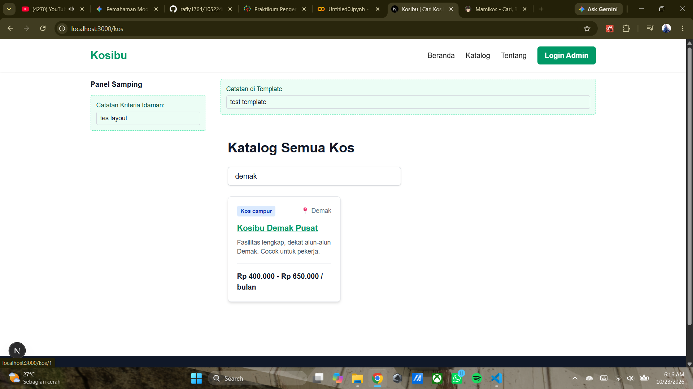
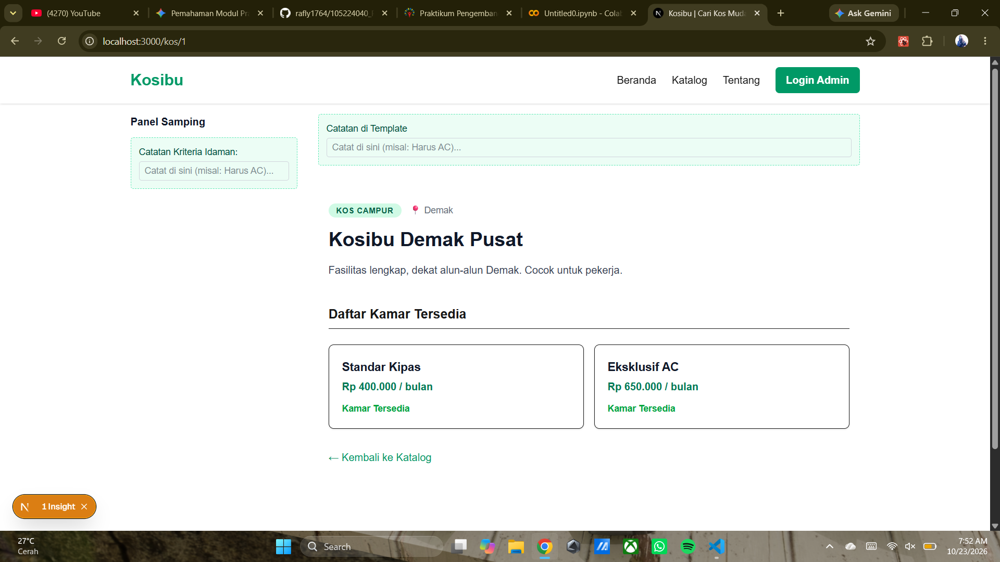

# Laporan Praktikum Modul 4: Layout, Template, dan Routing Next.js

**Nama:** Muhammad Rafly  
**NIM:** 105224040  
**Proyek:** Kosibu  

---

## 1. Pemahaman Konsep Layout vs Template
Pada proyek Kosibu, `layout.tsx` digunakan untuk elemen antar-muka yang persisten (bertahan dan tidak di-*render* ulang saat berpindah halaman), seperti Panel Samping. Sebaliknya, `template.tsx` digunakan untuk elemen yang harus dibuat ulang (di-*reset* statusnya) setiap kali terjadi navigasi rute. 

**Bukti Pengujian Layout vs Template:**
*(Kondisi sebelum navigasi: kotak input Layout dan Template sama-sama diisi teks)*

*(Kondisi sesudah navigasi ke halaman detail: teks di input Layout bertahan, teks di input Template otomatis terhapus/kosong)*

## 2. Pengujian Antar-muka Loading dan Error
Fitur penanganan status pemuatan lambat dan galat diimplementasikan menggunakan `loading.tsx` dan `error.tsx`. Pada arsitektur App Router, Next.js secara otomatis membungkus rute-rute ini menggunakan *React Suspense* dan *Error Boundary*.

**Bukti Pengujian:**
*(Tampilan antarmuka saat memuat data)*

*(Tampilan antarmuka saat menangkap galat)*

## 3. Analisis Keluaran Build Server
Keluaran dari perintah `npm run build` memperlihatkan proses optimasi perutean oleh Next.js. Rute statis (○) digunakan untuk halaman beranda atau katalog agar lebih cepat diakses, sementara rute dinamis (ƒ) menangani halaman seperti `/kos/[id]`.

**Bukti Tabel Keluaran Terminal Build:**

## 4. Pengujian Batas Server-Klien (Server-Only)
Modul `server-only` dimanfaatkan sebagai lapisan keamanan untuk mengunci berkas data sensitif (`lib/data.ts`). Pengujian ini membuktikan bahwa jika komponen klien (Client Component) mencoba mengakses data atau fungsi yang dikhususkan untuk peladen (Server Component), proses kompilasi akan langsung memblokirnya dan melemparkan peringatan *Build Error*.

**Bukti Pemblokiran Kebocoran Data:**

Melalui penyelesaian tahapan-tahapan di atas, implementasi arsitektur basis peladen pada Next.js telah berfungsi sempurna di dalam proyek Kosibu. Pemisahan akses data sisi klien dan peladen kini beroperasi dengan ketat, sistem perutean dinamis untuk entitas pangkalan data terhubung dengan baik, dan manajemen status antar-muka (*loading/error*) dapat memberikan umpan balik yang aman dan informatif kepada pengguna aplikasi.