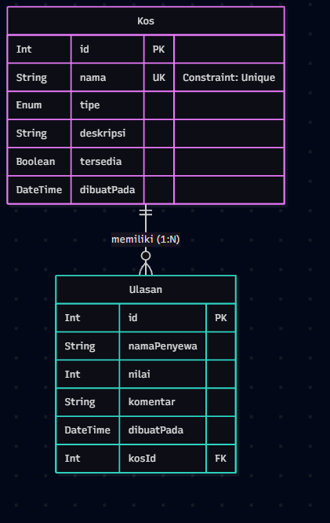
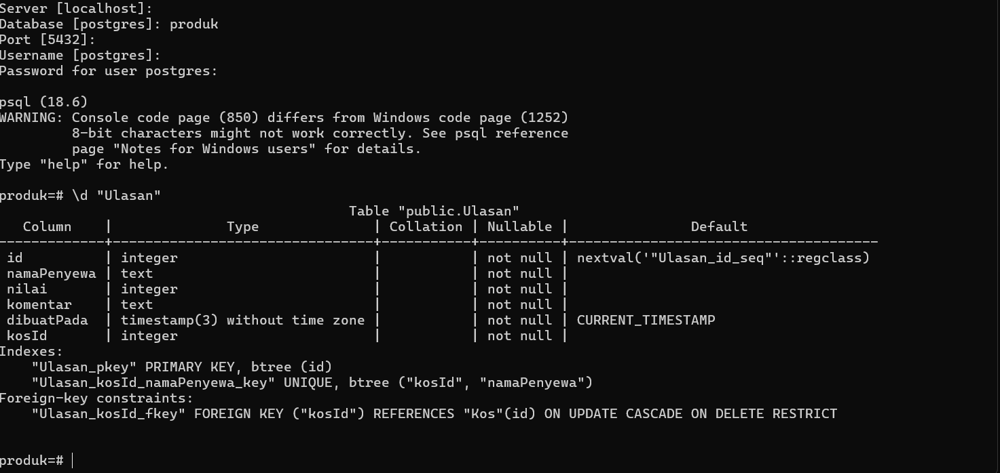

# Dokumen Teknis Modul 6 — PostgreSQL dan Prisma ORM

Nama/NIM   : Muhammad Rafly / 105224040
Repositori : https://github.com/rafly1764/Tubes_Kostibu_105224040/tree/praktikum/modul-06

## 1. Rancangan Data
- **Diagram dua entitas:** 
  
  *(Catatan: Taruh fail gambar diagram dari tugas pendahuluan ke dalam folder, lalu ubah teks di dalam kurung di atas dengan nama failnya)*

- **Relasi, kunci, dan constraint unik:** 
  Entitas `Kos` (1) memiliki relasi ke `Ulasan` (N). `Kos` memiliki Primary Key `id` dan Unique Constraint pada kolom `nama`. `Ulasan` memiliki Primary Key `id`, Foreign Key `kosId` (merujuk ke `Kos.id`), dan Unique Constraint gabungan `(kosId, namaPenyewa)`.

- **Alasan pemilihan aturan onDelete:** 
  Menggunakan aturan `RESTRICT`. Aturan ini melindungi integritas data dengan menolak penghapusan entitas Kos jika kos tersebut sudah memiliki ulasan. Ulasan adalah riwayat reputasi yang penting; jika Kos ingin dihapus, admin harus menghapus ulasannya terlebih dahulu (melalui transaksi) agar tidak ada data ulasan yang menggantung.

## 2. Skema dan Migrasi
- **Isi `prisma/schema.prisma`:**
  ```prisma
  generator client {
    provider = "prisma-client"
    output   = "../generated/prisma"
  }

  datasource db {
    provider = "postgresql"
  }

  enum TipeKos {
    Putra
    Putri
    Campuran
  }

  model Kos {
    id          Int      @id @default(autoincrement())
    nama        String   @unique
    tipe        TipeKos
    deskripsi   String
    tersedia    Boolean  @default(true)
    dibuatPada  DateTime @default(now())
    
    ulasan      Ulasan[]
  }

  model Ulasan {
    id          Int      @id @default(autoincrement())
    namaPenyewa String
    nilai       Int
    komentar    String
    dibuatPada  DateTime @default(now())
    
    kosId       Int
    kos         Kos      @relation(fields: [kosId], references: [id], onDelete: Restrict)

    @@unique([kosId, namaPenyewa])
  }

  Daftar folder prisma/migrations dan potongan migration.sql:
Folder migrasi: 20261104064732_init

-- CreateEnum
CREATE TYPE "TipeKos" AS ENUM ('Putra', 'Putri', 'Campuran');

-- CreateTable
CREATE TABLE "Kos" (
    "id" SERIAL NOT NULL,
    "nama" TEXT NOT NULL,
    "tipe" "TipeKos" NOT NULL,
    "deskripsi" TEXT NOT NULL,
    "tersedia" BOOLEAN NOT NULL DEFAULT true,
    "dibuatPada" TIMESTAMP(3) NOT NULL DEFAULT CURRENT_TIMESTAMP,

    CONSTRAINT "Kos_pkey" PRIMARY KEY ("id")
);

-- CreateTable
CREATE TABLE "Ulasan" (
    "id" SERIAL NOT NULL,
    "namaPenyewa" TEXT NOT NULL,
    "nilai" INTEGER NOT NULL,
    "komentar" TEXT NOT NULL,
    "dibuatPada" TIMESTAMP(3) NOT NULL DEFAULT CURRENT_TIMESTAMP,
    "kosId" INTEGER NOT NULL,

    CONSTRAINT "Ulasan_pkey" PRIMARY KEY ("id")
);

-- CreateIndex
CREATE UNIQUE INDEX "Kos_nama_key" ON "Kos"("nama");

-- CreateIndex
CREATE UNIQUE INDEX "Ulasan_kosId_namaPenyewa_key" ON "Ulasan"("kosId", "namaPenyewa");

-- AddForeignKey
ALTER TABLE "Ulasan" ADD CONSTRAINT "Ulasan_kosId_fkey" FOREIGN KEY ("kosId") REFERENCES "Kos"("id") ON DELETE RESTRICT ON UPDATE CASCADE;



3. Seed dan Prisma Client
Keluaran npx prisma db seed yang dijalankan dua kali:
PS D:\PEM WEB\Tubes\kosibu> npx prisma db seed
npm notice run kosibu@0.1.0 npx
npm notice run prisma db seed
Loaded Prisma config from prisma7.config.ts.

Running seed command `tsx prisma/seed.ts` ...
Seed selesai: 2 kos, 2 ulasan

The seed command has been executed.
PS D:\PEM WEB\Tubes\kosibu> npx prisma db seed
npm notice run kosibu@0.1.0 npx
npm notice run prisma db seed
Loaded Prisma config from prisma7.config.ts.

Running seed command `tsx prisma/seed.ts` ...
Seed selesai: 2 kos, 2 ulasan

The seed command has been executed. 

## 4. Operasi CRUD
- **Pemetaan Fungsi CRUD:**
  | Operasi | Berkas Next.js | Nama Fungsi | Metode Prisma Client |
  | :--- | :--- | :--- | :--- |
  | Create (Tambah) | `actions.ts` | `tambahKos` | `prisma.kos.create` |
  | Read (Tampil) | `page.tsx` | `getSemuaKos` | `prisma.kos.findMany` |
  | Update (Ubah) | `actions.ts` | `ubahKos` | `prisma.kos.update` |
  | Delete (Hapus) | `actions.ts` | `hapusKos` | `prisma.kos.delete` |

- **Tangkapan layar penanganan galat P2002 (Unique Constraint):**
  

5. Transaksi
Galat saat mencoba menghapus entitas Kos yang memiliki Ulasan (sebelum transaksi):
PrismaClientKnownRequestError: 
Invalid `prisma.kos.delete()` invocation:
The change you are trying to make would violate the required relation 'KosToUlasan' between the `Kos` and `Ulasan` models.
Penjelasan kode transaksi penghapusan:
Untuk mengatasi aturan RESTRICT, kita menggunakan prisma.$transaction. Transaksi ini membungkus dua operasi menjadi satu kesatuan: pertama, menghapus semua Ulasan yang memiliki kosId terkait menggunakan prisma.ulasan.deleteMany, kemudian menghapus data Kos utamanya menggunakan prisma.kos.delete. Jika operasi pertama gagal, operasi kedua otomatis dibatalkan (rollback), sehingga mencegah terjadinya basis data yang rusak.

## 6. Skenario Uji
| No | Skenario Pengujian | Hasil yang Diharapkan | Hasil Aktual | Status |
| :--- | :--- | :--- | :--- | :--- |
| 1 | `tambahKos` dengan nama baru | Kos berhasil ditambahkan ke basis data. | Data masuk ke tabel Kos PostgreSQL. | Berhasil |
| 2 | `tambahKos` dengan nama yang sudah ada | Muncul galat P2002 (Unique Constraint) ditangani di UI. | Menampilkan pesan error penolakan nama kembar. | Berhasil |
| 3 | `getSemuaKos` pada halaman utama | Menampilkan daftar Kos yang di-*seed* dan ditambahkan. | Daftar kos muncul terurut dari yang terbaru. | Berhasil |
| 4 | `ubahKos` mengganti tipe Kos | Tipe kos berubah tanpa mengubah id atau nama. | Kolom tipe terbarukan di database. | Berhasil |
| 5 | `hapusKos` pada kos tanpa ulasan | Kos langsung terhapus dari basis data. | Baris data kos terhapus bersih. | Berhasil |
| 6 | `hapusKos` pada kos dengan ulasan | Transaksi berjalan, ulasan dan kos terhapus bersamaan. | Ulasan dan kos terkait terhapus tanpa error *restrict*. | Berhasil |
| 7 | Menguji rollback pada transaksi hapus | Jika penghapusan kos sengaja digagalkan, ulasan batal terhapus. | Transaksi aman dari data menggantung (*orphan*). | Berhasil |
| 8 | Menambah ulasan dengan nama penyewa baru | Ulasan berhasil masuk dengan relasi ke Kos yang benar. | Ulasan terhubung ke `kosId` yang sesuai. | Berhasil |
| 9 | Menambah ulasan ganda di kos sama | Ditolak oleh *Unique Constraint* gabungan di entitas Ulasan. | Gagal karena melanggar indeks unik majemuk. | Berhasil |
| 10 | Memastikan tipe data Enum berfungsi | Menolak *input* di luar nilai 'Putra', 'Putri', 'Campuran'. | Validasi tipe data menolak nilai ilegal. | Berhasil |

- **Persentase Kelulusan Pengujian:** 10/10 skenario berhasil (**100%**)

## 7. Kendala dan Penyelesaian
- **Kendala 1:** Terjadi galat `MODULE_NOT_FOUND` pada modul `@prisma/client/runtime/client` saat menjalankan perintah *seed* data awal.
  - **Penyelesaian:** Menginstal ulang pustaka klien Prisma ke versi 7 (`npm install @prisma/client@7`) dan membangkitkan ulang modul klien menggunakan `npx prisma generate`.
- **Kendala 2:** Terjadi galat konfigurasi P1012 pada skema Prisma karena versi Prisma 7 tidak lagi mendukung blok konfigurasi URL langsung di dalam fail `schema.prisma`.
  - **Penyelesaian:** Memindahkan parameter koneksi basis data sepenuhnya ke fail konfigurasi terpisah `prisma7.config.ts`.
- **Kendala 3:** VS Code (TypeScript Server) lambat mendeteksi (*caching*) fail `lib/prisma.ts` yang baru dibuat sehingga variabel Prisma Client masih digarisbawahi merah.
  - **Penyelesaian:** Melakukan *restart* pada TypeScript Server di VS Code menggunakan palet perintah (`Ctrl+Shift+P` -> `Restart TS Server`).

## 8. Catatan Pemanfaatan AI
- **Alat:** Asisten AI (Gemini)
- **Perintah Utama:** Membantu menyusun struktur dokumen teknis laporan Modul 6, merumuskan penanganan galat `P2002` pada *Server Actions*, menyusun skrip transaksi Prisma, memandu tata cara perbaikan galat direktori (`Cannot find module`), serta memberikan arahan alur kerja Git.
- **Bagian yang Digunakan:** Penyusunan kode `actions.ts`, perbaikan konfigurasi jalur *import*, pembuatan antarmuka halaman uji coba sementara di `app/tambah/page.tsx`, format tabel skenario pengujian, dan tata letak laporan Markdown.
- **Cara Memverifikasinya:** Memvalidasi seluruh kode melalui pengujian langsung (*live testing* di peramban `localhost:3000/tambah`), memastikan tidak ada galat kompiler TypeScript di VS Code, serta memverifikasi keluaran galat unik (P2002) dan transaksi basis data secara nyata sesuai skenario modul.