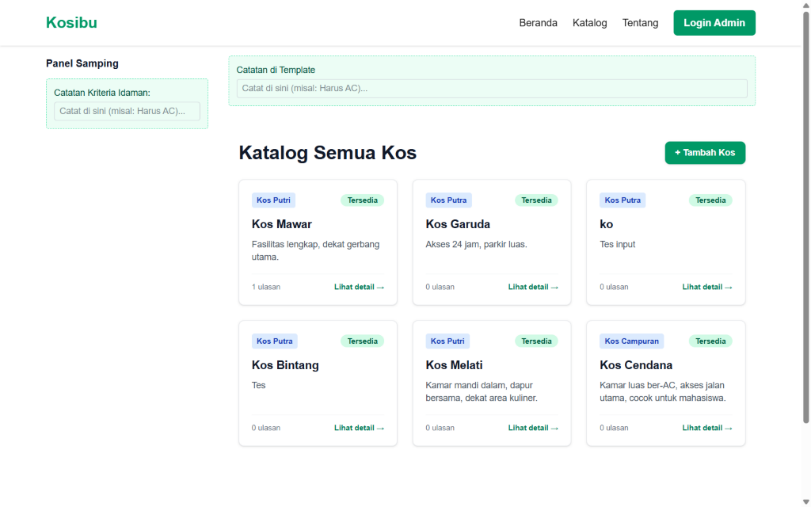
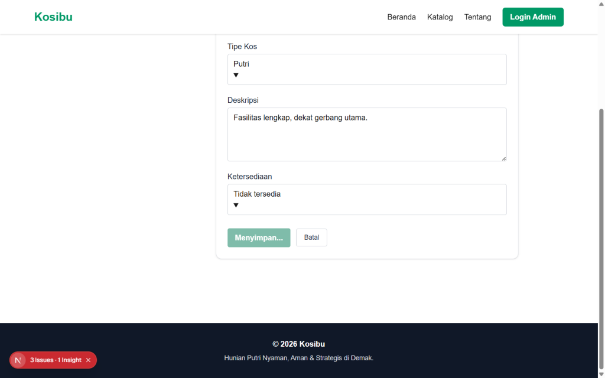
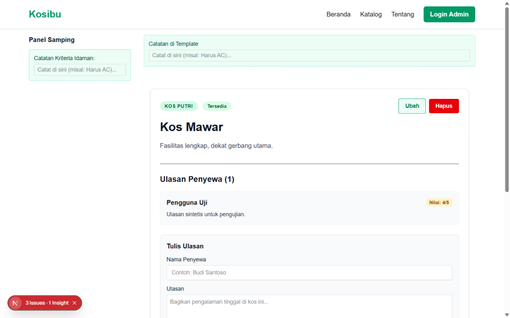
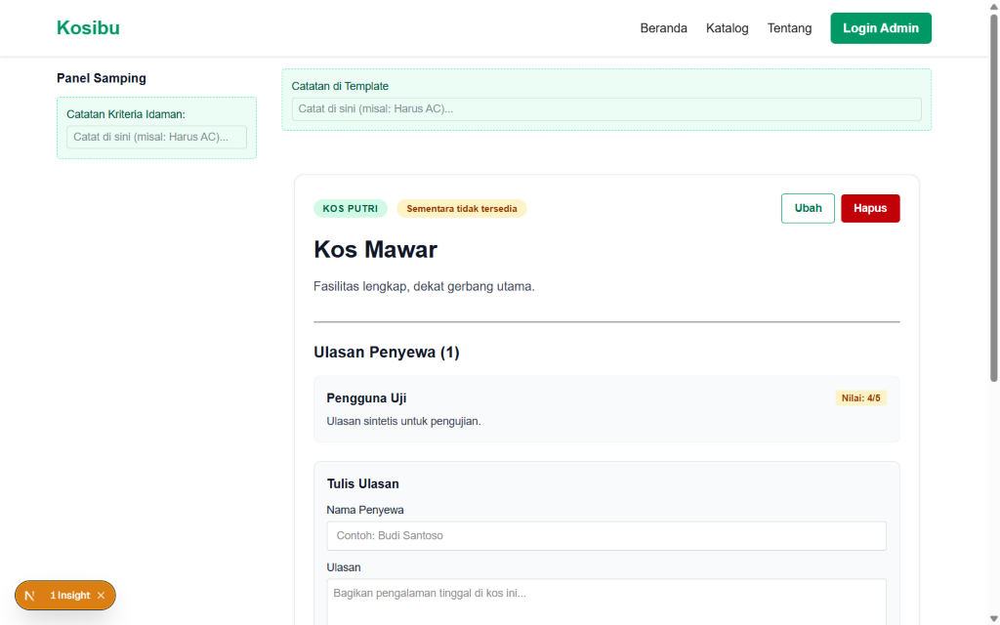
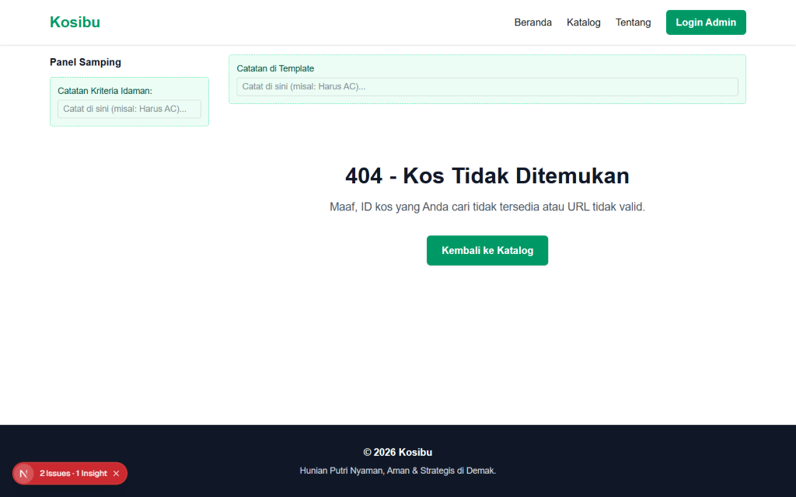
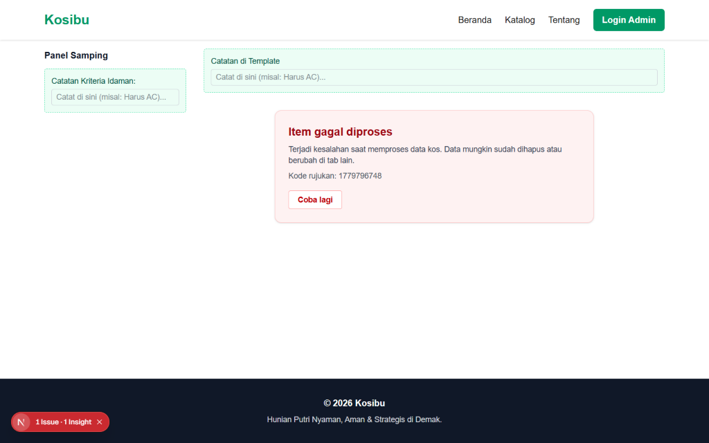
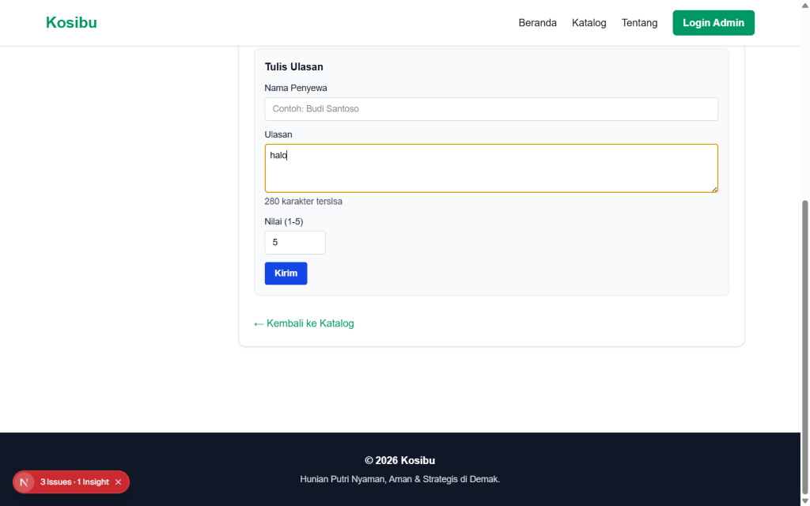
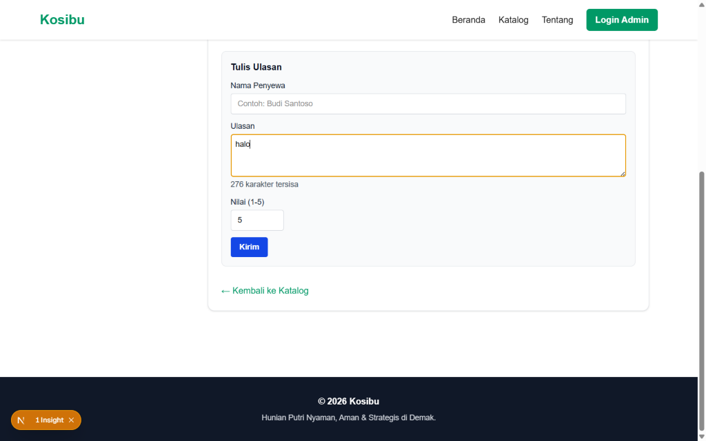

# Dokumen Teknis Modul 7 — Debugging dan Telaah Kode

- **Nama / NIM:** Muhammad Rafly / 105224040
- **Repositori:** https://github.com/rafly1764/Tubes_Kostibu_105224040
- **Pull Request:** *(isi URL PR `praktikum/modul-07` → `main`)*
- **Pasangan Telaah:** Michael Alexander Newton (https://github.com/Axcelion017/Tugas-Besar-CS5-PAW-Kripto-Keamanan-Siber)

## 1. Lingkungan dan Konfigurasi Debugger
- **Lingkungan:** Node.js `v24.21.0`, Next.js `16.4.2`, Prisma `7.10.1`, Zod `4.6.7`, PostgreSQL (`produk@localhost:5432`), Chrome + React DevTools, branch `praktikum/modul-07`, commit awal `abb7278`.
- **Konfigurasi Debugger:** [`.vscode/launch.json`](../../.vscode/launch.json) — 3 mode: `Next.js: debug server-side` (`npm run dev -- --inspect`), `Next.js: debug client-side` (Chrome `http://localhost:3000`), dan `Next.js: debug full stack` (`debugWithChrome`, pattern `"- Local:.+(https?://.+)"`).
- **Log Query Prisma:** [`lib/prisma.ts`](../../lib/prisma.ts) → `new PrismaClient({ adapter, log: ["query", "warn", "error"] })`.
- **Bukti Checkpoint 1:** `Debugger listening on ws://127.0.0.1:9229/...` aktif dan `GET /kos` mencetak `prisma:query SELECT "public"."Kos"."id", ... FROM "public"."Kos" ... ORDER BY "public"."Kos"."id" ASC`.



## 2. Daftar Galat
| No | Issue | Gejala | Lapisan | Akar Penyebab | Commit Perbaikan |
|----|-------|--------|---------|---------------|------------------|
| 1 | `#1` | Status `"Tidak tersedia"` tetap `"Tersedia"` walau pesan `"Perubahan disimpan."` muncul. | Server (Validasi Zod `lib/skema.ts`) | `z.coerce.boolean()` memakai `Boolean("false")` → `true`. | `fix(kos): status tersedia selalu true akibat z.coerce.boolean` |
| 2 | `#2` | Hapus kos tanpa ulasan tidak pindah ke `/kos` (tampil 404) & cetak `"Gagal menghapus"`. | Server Action (`app/kos/actions.ts`) | `redirect("/kos")` di dalam `try/catch` sehingga `NEXT_REDIRECT` ditelan `catch`. | `fix(kos): redirect tertelan dan P2003 saat hapus kos` |
| 3 | `#3` | Hapus kos berulasan gagal diam-diam tanpa pesan UI; galat tak terduga (`P2025`) tak ditangani. | Basis data (`P2003`) & Server Action | Foreign key `Ulasan_kosId_fkey` (`Restrict`) ditelan `catch`; belum ada `app/kos/[id]/error.tsx`. | `fix(kos): redirect tertelan dan P2003 saat hapus kos` |
| 4 | `#4` | Penghitung sisa karakter ulasan tetap `"280 karakter tersisa"` saat mengetik. | Peramban (`components/FormUlasan.tsx`) | `useEffect(() => setSisa(280 - isi.length), [])` memakai dependensi kosong `[]`. | `fix(ulasan): sisa karakter dihitung saat render` |

## 3. Catatan Penelusuran

### Galat 1 — Status `"Tidak tersedia"` Tidak Tersimpan (`#1`)
- **Reproduksi:** Data awal `Kos Mawar` (`id=1`, `tersedia=true`). Buka `/kos/1/edit` → pilih `"Tidak tersedia"` → klik **Simpan** → buka `/kos/1`. **Diharapkan:** `"Sementara tidak tersedia"`. **Aktual:** tetap `"Tersedia"` (**5/5 percobaan**).
- **Bukti sebelum:** Network `POST /kos/1/edit` (header `Next-Action`) mengirim `tersedia="false"` (status `200`), log Prisma menjalankan `UPDATE`, namun evaluasi server menunjukkan `z.coerce.boolean().safeParse("false")` → `{ success: true, data: true }` (`Boolean("false") === true`).
  
  
- **Akar penyebab & perbaikan ([`lib/skema.ts`](../../lib/skema.ts)):** Ganti `z.coerce.boolean()` menjadi `z.stringbool()`.
  ```ts
  tersedia: z.stringbool(), // "true" -> true, "false" -> false; nilai lain gagal validasi
  ```
- **Bukti sesudah:** Reproduksi diulang 5 kali di `/kos/1/edit`; `z.stringbool().safeParse("false")` → `false` dan `/kos/1` menampilkan **`Sementara tidak tersedia`** (**5/5 percobaan**).
  

### Galat 2 — `redirect()` Tertelan `try/catch` (`#2`)
- **Reproduksi:** Data awal `Kos Cendana` (`id=14`, `0 ulasan`). Buka `/kos/14` → klik **Hapus**. **Diharapkan:** terhapus dan redirect ke `/kos`. **Aktual:** data terhapus, URL tetap di `/kos/14` (tampil `404`), terminal cetak `"Gagal menghapus"` (**2/2 percobaan**).
- **Bukti sebelum:** Saat `e` diinspeksi di `catch`, `e.message === 'NEXT_REDIRECT'` dan `e.digest === 'NEXT_REDIRECT;push;/kos;307;'` tepat pada `app/kos/actions.ts:34` setelah `prisma:query DELETE FROM "public"."Kos"`.
  
- **Akar penyebab & perbaikan ([`app/kos/actions.ts`](../../app/kos/actions.ts)):** `redirect()` melempar galat internal Next.js sehingga wajib dipanggil di luar `try/catch` (digabung bersama perbaikan Galat 3).
- **Bukti sesudah:** Hapus `Kos Cendana` (`id=18`, 0 ulasan) langsung `COMMIT` dan otomatis redirect ke `/kos` tanpa log galat.

### Galat 3 — Gagal Hapus Kos Berulasan (`P2003`) & Error Boundary (`P2025`) (`#3`)
- **Reproduksi:** Data awal `Kos Mawar` (`id=1`, `1 ulasan`). Buka `/kos/1` → klik **Hapus**. **Diharapkan:** ulasan & kos terhapus atomik lalu redirect ke `/kos`; galat tak terduga tampil di `error.tsx`. **Aktual:** gagal diam-diam tanpa pesan UI, log hanya `"Gagal menghapus"` (**2/2 percobaan**).
- **Bukti sebelum:** Mengganti sementara ke `console.error(e)` memunculkan stack trace `PrismaClientKnownRequestError` pada `app/kos/actions.ts:32`: `code: 'P2003'`, `Foreign key constraint violated on the constraint: Ulasan_kosId_fkey (RestrictViolation)`.
- **Akar penyebab & perbaikan ([`app/kos/actions.ts`](../../app/kos/actions.ts) & [`app/kos/[id]/error.tsx`](../../app/kos/%5Bid%5D/error.tsx)):** Hapus atomik dengan `$transaction`, biarkan galat tak terduga naik ke `error.tsx` (dengan prop `retry()`), dan `redirect("/kos")` di luar `try/catch`.
  ```ts
  export async function hapusKos(id: number) {
    await prisma.$transaction([
      prisma.ulasan.deleteMany({ where: { kosId: id } }),
      prisma.kos.delete({ where: { id } }),
    ]);
    revalidatePath("/kos");
    redirect("/kos");
  }
  ```
- **Bukti sesudah:** Hapus `Kos Mawar` (`1 ulasan`) menjalankan `DELETE Ulasan` → `DELETE Kos` → `COMMIT` dan redirect ke `/kos`. Uji hapus 2 tab pada `Kos Melati` (`id=17`): tab 2 memicu `ROLLBACK` + `PrismaClientKnownRequestError` `code: 'P2025'` (`digest: '1779796748'`) yang tercatat di terminal dan tampil ramah di `error.tsx`.
  

### Galat 4 — Penghitung Karakter Ulasan Membeku (`#4`)
- **Reproduksi:** Buka `/kos/1` → ketik `"halo"` pada textarea Ulasan di `FormUlasan`. **Diharapkan:** `"276 karakter tersisa"`. **Aktual:** tetap `"280 karakter tersisa"` (**5/5 percobaan**).
- **Bukti sebelum:** State `isi` berubah namun `sisa` tetap `280` karena `useEffect` berdependensi `[]` tidak berjalan ulang saat mengetik; `npm run lint` juga melaporkan `react-hooks/set-state-in-effect` dan `react-hooks/exhaustive-deps` di `components/FormUlasan.tsx:15-16`.
  
- **Akar penyebab & perbaikan ([`components/FormUlasan.tsx`](../../components/FormUlasan.tsx)):** Hapus state `sisa` & `useEffect`, hitung sebagai nilai turunan saat render:
  ```tsx
  const [isi, setIsi] = useState("");
  const sisa = 280 - isi.length;
  ```
- **Bukti sesudah:** Ketik `"halo"` langsung menampilkan **`276 karakter tersisa`** (**5/5 percobaan**); `npm run lint` dan `npx tsc --noEmit` lulus bersih (**0 error, 0 warning**).
  

## 4. Keputusan Teknis
- **`z.stringbool()` vs alternatif:** Lebih tepat daripada `z.coerce.boolean()` (salah mengonversi `"false"` → `true`), lebih aman daripada parsing manual (yang tidak menolak string acak seperti `"abc"`), dan lebih ringkas daripada `z.enum(["true", "false"]).transform(...)` karena bawaan Zod 4.
- **Aturan hapus kos berulasan (`$transaction` vs `Cascade` vs tolak):** Mempertahankan `onDelete: Restrict` di skema (konsisten dengan Modul 6 agar tidak ada hapus tak sengaja di level SQL) lalu memakai `prisma.$transaction` di `hapusKos` agar penghapusan ulasan dan kos bersifat atomik (*all-or-nothing* — otomatis `ROLLBACK` bila `P2025`), sekaligus lebih praktis daripada menolak hapus dan memaksa admin menghapus ulasan satu per satu.
- **Nilai turunan saat render vs `useEffect`:** Menghitung `const sisa = 280 - isi.length` saat render menjaga satu sumber kebenaran (*single source of truth*), hanya 1 render per ketikan, dan menghindari *cascading render* dari `useEffect([isi])` yang ditolak ESLint (`react-hooks/set-state-in-effect`).
- **Server Action (`StatusForm`) vs `error.tsx`:** Galat terduga yang bisa diperbaiki pengguna (validasi Zod, `P2002` duplikat ulasan) dikembalikan via `StatusForm`; galat tak terduga (`P2025`, gangguan DB) tidak boleh ditelan `catch` (OWASP A10:2025) melainkan diteruskan ke `error.tsx` agar stack trace tercatat di server dan pengguna menerima `error.digest` + tombol `retry()`. `redirect()` selalu di luar `try/catch`.

## 5. Telaah Kode
- **PR Pasangan (Michael Alexander Newton):** *(tautan PR pasangan)* — **Keputusan:** *(Approve / Request changes + alasan teknis)*
  1. `L... | Validasi | [masalah] | [perbaikan]` *(disertai blok `suggestion`)*
  2. `L... | Penanganan Galat | [masalah] | [perbaikan]`
  3. `Nit: L... | Keterbacaan | [masalah] | [perbaikan]`
- **Tanggapan atas review di PR sendiri:**
  - `[Komentar 1]` → `[Diterapkan di commit ... / Ditolak]` — Alasan teknis: `[...]`
  - `[Komentar 2]` → `[Diterapkan di commit ... / Ditolak]` — Alasan teknis: `[...]`

## 6. Kendala dan Penyelesaian
1. **`.vscode/launch.json` awal tanpa `-- --inspect`** → ditambahkan flag `-- --inspect` agar inspector port `9229` aktif.
2. **Error Next.js 16.4 `blocking-prerender-current-time` (`new Date()`)** saat `cacheComponents: true` membaca Prisma di Server Component → diselesaikan dengan `await connection()` dari `"next/server"` di dalam `<Suspense>`.
3. **Bentrok port `9229` (`address already in use`) & cache `globalThis.prisma`** → hentikan semua sesi `npm run dev` sebelum memulai ulang debugger dengan `F5`.

## 7. Catatan Pemanfaatan AI
- **Alat & perintah utama:** Antigravity / Gemini — menerapkan kode usulan AI Modul 7 pada entitas `Kos`/`Ulasan`, menyempurnakan `.vscode/launch.json`, menganalisis & memperbaiki 4 galat beserta `app/kos/[id]/error.tsx`, dan menyusun dokumen teknis serta `AI_LOG.md`.
- **Kode AI & galat yang ditemukan:** `lib/skema.ts` (`z.coerce.boolean()`), `app/kos/actions.ts` (`redirect` di dalam `try`, `P2003` ditelan `catch`), dan `components/FormUlasan.tsx` (`useEffect` dependensi kosong `[]`).
- **Perubahan & cara verifikasi:** Seluruh 4 galat diperbaiki pada akar penyebabnya (dicatat di [`AI_LOG.md`](../../AI_LOG.md)), lalu diverifikasi dengan reproduksi ulang sebelum vs sesudah di `localhost:3000` (5/5 ubah status, hapus tanpa & dengan ulasan, uji 2 tab `P2025` → `error.tsx`, ketik `"halo"` → `276 karakter tersisa`), pemeriksaan log `prisma:query`/stack trace, serta `npm run lint` dan `npx tsc --noEmit` (keduanya lulus 0 error).
